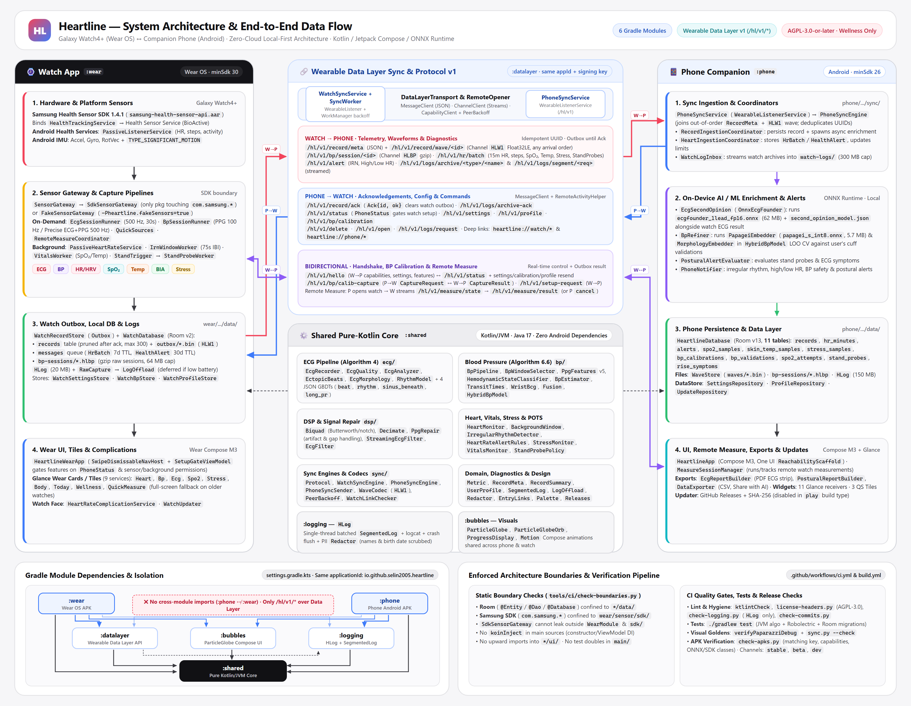
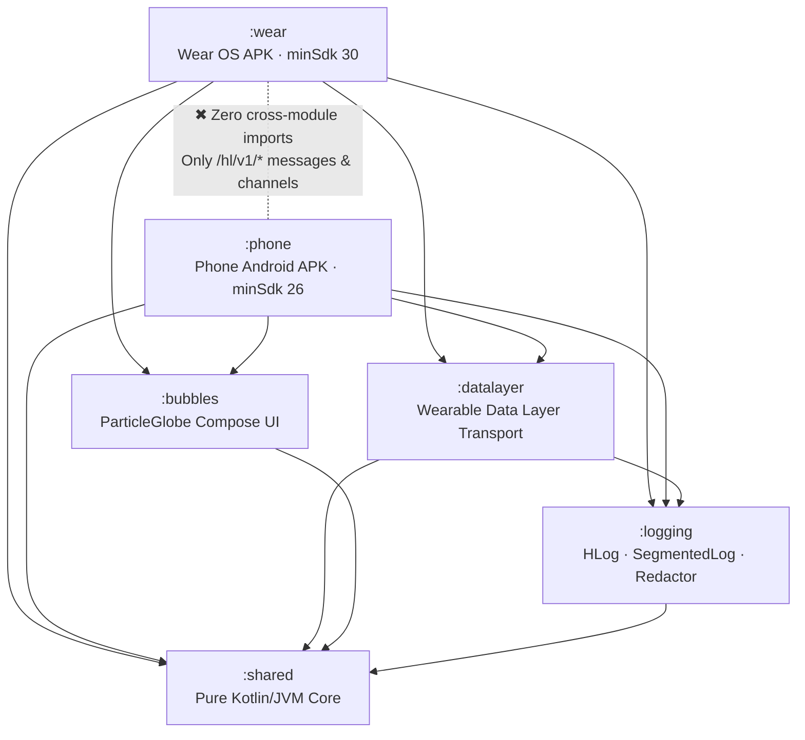
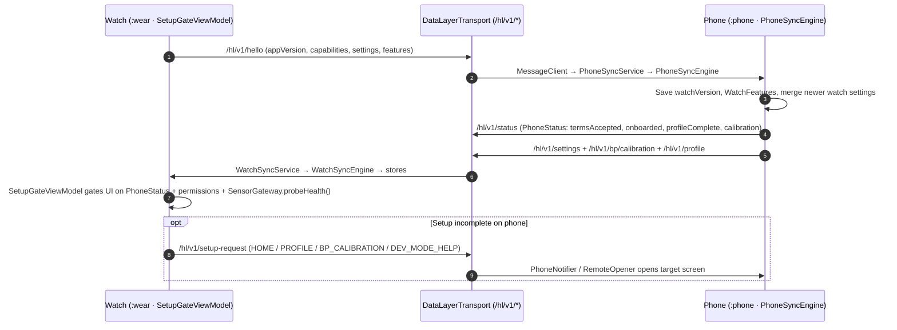
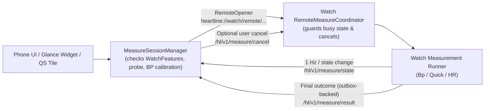
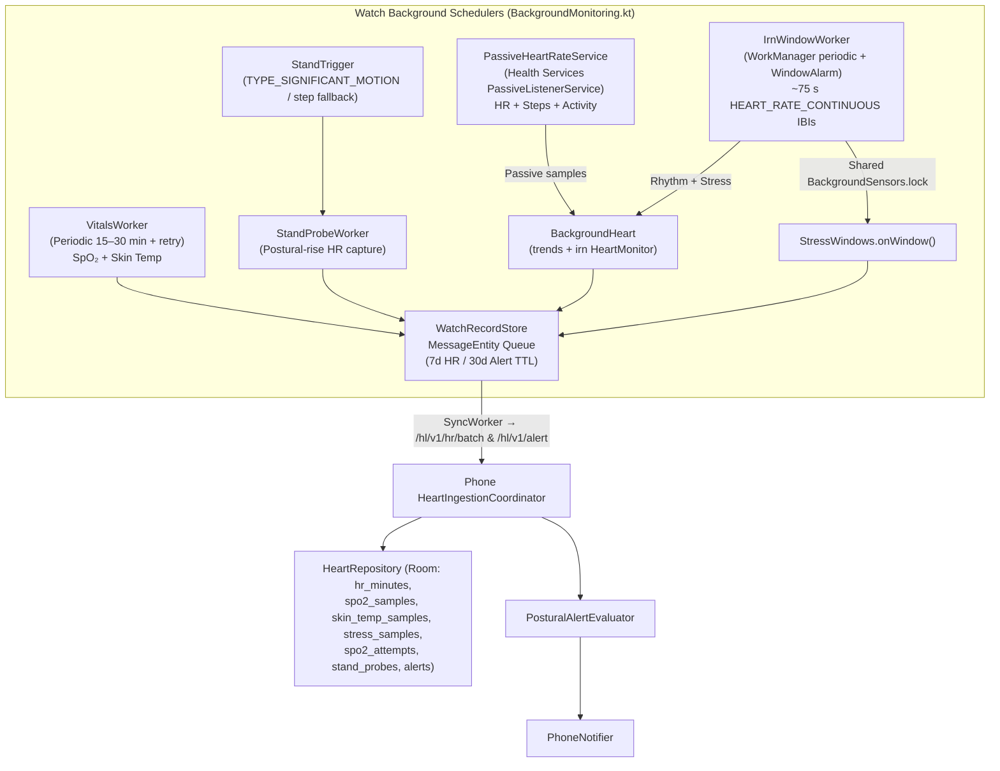

# Heartline System Architecture

Heartline is an open-source, local-first Android and Wear OS wellness companion for **Samsung Galaxy Watch4 and newer**. Measurements are captured on the watch, transferred directly to the paired phone over the Android Wearable Data Layer, enriched with on-device signal processing and neural models, and stored solely on the user's devices—with no accounts, no cloud servers, and no telemetry.

> **Wellness scope:** Heartline is a general wellness application, not a medical device. None of its labels, estimates, or reports are medical diagnoses. See [the medical disclaimer](../../legal/MEDICAL_DISCLAIMER.md).

---

## 1. Architecture Flow Overview



---

## 2. Core Design Principles

1. **Zero-cloud local-first storage:** Health data stays on the watch until delivered and lives on the phone in Room (`HeartlineDatabase`), binary waveform files (`WaveStore`), and DataStore preferences. The only network feature is the opt-in GitHub Releases update check in the phone/watch GitHub builds (`BuildConfig.UPDATER = true`, disabled in the `play` build type).
2. **Paired identity contract:** Wearable Data Layer discovery requires both APKs to share the same `applicationId` (`io.github.selin2005.heartline`) and the same signing certificate. Both apps advertise capabilities (`heartline_phone` and `heartline_watch` via `res/values/wear.xml`) and communicate exclusively over `/hl/v1/*` paths (`Protocol.VERSION = 1`).
3. **Pure-Kotlin algorithmic core:** Signal filtering, ECG analysis, blood-pressure estimation, heart-rate/HRV tracking, stress scoring, vitals monitoring, postural-rise detection, and both sync state machines live in `:shared` with zero Android dependencies so they can run identically on phone, watch, and fast JVM unit tests.
4. **Hard boundary isolation:** Architectural layering (data vs. UI, Samsung SDK containment, dependency injection, logging, and module isolation) is statically enforced in CI by [tools/ci/check-boundaries.py](../../tools/ci/check-boundaries.py).
5. **Reproducible dev & offline evaluation:** `-Pheartline.fakeSensors=true` swaps `SdkSensorGateway` for `FakeSensorGateway` on the watch, `-Pheartline.demoData=true` seeds sample records on the phone, and `:shared` exposes `:shared:ecgEval` / `:shared:bpEval` CLI replay tasks alongside Python ML pipelines in `tools/ml/`.

---

## 3. Gradle Modules & Dependency Graph



| Module | Type | Key Dependencies | Responsibilities |
|---|---|---|---|
| **`:shared`** | Kotlin/JVM (`Java 17`) | `kotlinx.serialization`, `kotlinx.coroutines` | Domain models (`Metric`, `RecordMeta`, `RecordSummary`), DSP (`Biquad`, `Decimate`, `PpgRepair`, `StreamingEcgFilter`), ECG Algorithm 4 + 4 JSON GBDTs, BP Algorithm 7 + `HybridBpModel`, background heart/IRN/stress/vitals/POTS monitors, `Protocol` + `WatchSyncEngine` / `PhoneSyncEngine` + `SyncMessageQueue` + `WaveCodec` (`HLW1`), `SegmentedLog`, `LogOffload`, `Redactor`, `Palette`, `Releases`, and `GitHubReleaseClient`. |
| **`:logging`** | Android Library | `:shared` | `HLog` structured ring-buffer logger (20 MB watch / 150 MB phone budgets) with single-thread batched disk writes, logcat mirroring, uncaught-exception flush, and PII redaction (`Redactor`). |
| **`:datalayer`** | Android Library | `:shared`, `:logging`, Play Services Wearable, `wear-remote-interactions` | `DataLayerTransport` (`SyncTransport` + `PeerDirectory`) wrapping `MessageClient`, `ChannelClient`, `CapabilityClient`, and `NodeClient` with `PeerBackoff`; `RemoteOpener` wrapping `RemoteActivityHelper` for cross-device `heartline://` deep links. |
| **`:bubbles`** | Android Compose Library | `:shared`, Jetpack Compose | Animated `ParticleGlobe`, `ParticleGlobeOrb`, `ProgressDisplay`, and `Motion` visuals shared across phone and watch measurement/waiting screens. |
| **`:wear`** | Wear OS Application | `:shared`, `:datalayer`, `:logging`, `:bubbles`, Samsung Health Sensor SDK 1.4.1 (`aar`), Health Services, Room, WorkManager, Koin, Wear Compose M3, Glance Wear | Watch UI (`HeartlineWearApp`), `SdkSensorGateway` / `FakeSensorGateway`, session runners (`EcgSessionRunner`, `BpSessionRunner`, `QuickSources`), `RemoteMeasureCoordinator`, background workers (`PassiveHeartRateService`, `IrnWindowWorker`, `VitalsWorker`, `StandTrigger` / `StandProbeWorker`), `WatchRecordStore` (`WatchDatabase` v3), `LauncherPrefs`, `SyncWorker` / `WatchSyncService`, 9 Wear tiles/cards, `HeartRateComplicationService`, and `WatchUpdater` (backed by `GitHubReleaseClient`). |
| **`:phone`** | Android Application | `:shared`, `:datalayer`, `:logging`, `:bubbles`, ONNX Runtime (`1.23.2`), Room, DataStore, WorkManager, Koin, Compose M3, Glance AppWidget | Companion UI (`HeartlineApp`), `PhoneSyncService` + ingestion coordinators (`RecordIngestionCoordinator`, `HeartIngestionCoordinator`, `WatchLogInbox`), durable `RecordEnrichmentWorker`, on-device AI enrichment (`EcgSecondOpinion` with ECGFounder, `BpRefiner` with PaPaGei, serialized via `OnnxRuntimeLock` / `OnnxInferenceDispatcher`), `MeasureSessionManager`, `HeartlineDatabase` (v14, 12 tables) + `WaveStore`, PDF/CSV/AI exports (`EcgReportBuilder`, `PosturalReportBuilder`, `DataExporter`), 11 Glance home widgets, 3 Quick Settings tiles, and `Updater` (backed by `GitHubReleaseClient`). |
| **`tools/`** | Python & Shell Tooling | Python 3.12, PyTorch/ONNX/NumPy (ML), `oxipng` (screenshots) | CI boundary/logging/license/commit/APK checks (`tools/ci/`), ML training/export/eval (`tools/ml/ecg-eval`, `ecg-ml`, `bp-ml`), screenshot synchronization (`tools/screenshots/`), replay (`tools/replay/`), and release automation (`tools/release/`). |

---

## 4. End-to-End Runtime Flows

### 4.1 Watch ↔ Phone Handshake & Feature Gating

Whenever the watch app starts or checks its link (`WatchLinkChecker`), it sends `/hl/v1/hello` with its version, supported `Metric` capabilities, sensor service version, local settings, and feature flags (such as `REMOTE_MEASURE`). The phone updates its view of the watch and replies with `PhoneStatus`, current `MonitorSettings`, `BpCalibration`, and `UserProfile`.



### 4.2 On-Demand Measurement, Outbox Sync & Phone Enrichment

Measurements recorded on the watch are persisted locally in `WatchRecordStore` before sync begins, ensuring zero data loss if Bluetooth disconnects. Metadata and binary waveforms travel on separate channels and may arrive in any order; `PhoneSyncEngine` joins them by UUID, schedules durable phone-side enrichment via `RecordEnrichmentWorker` (WorkManager), and sends an idempotent acknowledgement.

```mermaid
sequenceDiagram
  autonumber
  participant S as SensorGateway / Runner (:wear)
  participant Out as WatchRecordStore (Room v3 + files)
  participant SW as SyncWorker + WatchSyncEngine
  participant PE as PhoneSyncService + PhoneSyncEngine
  participant RIC as RecordIngestionCoordinator
  participant DB as HeartlineDatabase (v14) + WaveStore
  participant AI as RecordEnrichmentWorker (WorkManager)

  S->>Out: add(RecordMeta, wave?) → Room records + outbox/<id>.bin (HLW1)
  Note over S,Out: BP also writes gzipped bp-sessions/<id>.hlbp
  SW->>PE: /hl/v1/record/meta (MessageClient JSON)
  SW->>PE: /hl/v1/record/wave/<id> (ChannelClient HLW1 Float32LE)
  SW->>PE: /hl/v1/bp/session/<id> (ChannelClient HLBP gzip, if BP)
  PE->>PE: Join meta + wave in Mutex map (any arrival order; deduplicate by UUID)
  PE->>RIC: save(meta, wave)
  RIC->>DB: Insert RecordEntity + write waves/<id>.bin
  PE->>SW: /hl/v1/record/ack (Ack{id, ok=true})
  SW->>Out: markDelivered(id) → deletes outbox wave & prunes old delivered records (keep 300)
  RIC->>AI: Enqueue RecordEnrichmentWorker(recordId, notifiedSafety)
  AI->>DB: BpRefiner.refineIfReady() → Update RecordSummary + safety notice if needed
  AI->>DB: EcgSecondOpinion.onRecordSaved() → RecordRepository.updateEcgSecondOpinion()
  AI->>DB: ProfileRepository.onRecordSaved() (sync newer BIA weight)
```

### 4.3 Phone-Initiated Remote Measurement

Measurements that do not require two fingers on the watch's electrodes (`Metric.measuresOnPhone == true`: Blood Pressure, Heart Rate, SpO₂, Skin Temperature, Stress) can be started directly from the phone app, a Glance home-screen widget, or a Quick Settings tile.



### 4.4 Background Monitoring, Vitals & Postural-Rise Pipeline

All-day tracking combines low-power Android Health Services passive monitoring, scheduled WorkManager sensor windows, and a significant-motion trigger without holding a permanent foreground notification:



---

## 5. Sensor Integration & Algorithmic / ML Pipelines

### 5.1 Watch Sensor Boundary (`wear/.../sensor/`)

* **`SensorGateway` interface (`SensorGateway.kt`):** All watch ViewModels, workers, and runners depend only on `SensorGateway`, `HrSource`, `EcgSource`, `PpgSource`, `QuickSources`, and `BpAuxSensors`.
* **`SdkSensorGateway` (`wear/.../sensor/sdk/`):** The sole package permitted to import `com.samsung.*`. Binds `HealthTrackingService` from Samsung Health Sensor SDK 1.4.1 (`wear/libs/samsung-health-sensor-api.aar`) to access BioActive trackers:
  * `ECG_ON_DEMAND` (500 Hz ECG + synchronized PPG channel for pulse arrival time)
  * `PPG_ON_DEMAND` (100 Hz green / IR / red PPG) + `AndroidImuRecorder` (accelerometer, gyroscope, rotation vector)
  * `HEART_RATE_CONTINUOUS` (1 Hz HR + beat-to-beat IBIs)
  * `SPO2_ON_DEMAND`, `SKIN_TEMPERATURE_ON_DEMAND`, `BIA_ON_DEMAND`, and `EDA_CONTINUOUS`
* **`FakeSensorGateway` (`FakeSensorGateway.kt`):** Synthetic generator implementation wired by `WearModule` when built with `-Pheartline.fakeSensors=true`.

### 5.2 ECG Pipeline (Watch Algorithm 4 + Phone Second Opinion)

1. **On the Watch (`:shared/ecg/`):** `EcgRecorder` manages finger-contact debounce (`WAITING → ARMING → RECORDING ⇄ PAUSED`). `EcgAnalyzer` filters each contact segment (`0.5–40 Hz`, mains notch), detects beats with dual QRS detectors, clusters beat shapes, scores per-second signal quality (`EcgQuality`), classifies individual beats (`EctopicBeats` via `beat_model.json`), evaluates underlying sinus rhythm (`sinus_beneath_model.json`), measures median-beat PR/QRS morphology (`EcgMorphology` via `long_pr_model.json`), and classifies overall wellness rhythm (`RhythmClassifier` + `rhythm_model.json`). All 4 models (`~2 MB` total in `shared/src/main/resources/ecg/`) execute in pure Kotlin.
2. **On the Phone (`phone/.../ecg/EcgSecondOpinion.kt`):** Runs durably from `RecordEnrichmentWorker` via `OnnxEcgFounder` (`ecg/ecgfounder_1lead_fp16.onnx`, 62 MB fp16, atomically extracted and version-stamped into `noBackupFilesDir` by `extractModelAsset`, serialized under `OnnxRuntimeLock` on `OnnxInferenceDispatcher` in `phone/.../ml/OnnxSupport.kt`) to compute 150 label probabilities, combines them with `EcgAnalyzer` features in `ecg/second_opinion_model.json`, and persists the second opinion without overwriting symptoms or notes via `RecordRepository.updateEcgSecondOpinion()`, displaying it *alongside* the watch's result.

### 5.3 Blood Pressure Pipeline (Watch Algorithm 7 + Phone Hybrid Refinement)

1. **On the Watch (`:shared/bp/`):** Optional skin-temperature and 5 s EDA auxiliary check (`BpAuxSensors`) → quick PPG (100 Hz, 20–60 s) or precise ECG+PPG with arm-raise hydrostatic maneuver (500 Hz, 34 s) → motion gating (`ImuStreams`) → `PpgRepair` → `BpWindowSelector` (steadiest 20 s, or 45 s if irregular) → `PpgFeatures` v6 → `HemodynamicStateClassifier` (`STEADY` / `TRANSIENT` / `COMPENSATORY` / `IRREGULAR`) → multi-channel estimation (`BpEstimator` PWA green/IR, `WristBcg` / `PulseArrival` `TransitTimes`, `HydrostaticCalibration`) → GLS correlated-noise `BpFusion` + posture adjustment + `BpSafety`.
2. **On the Phone (`phone/.../bp/BpRefiner.kt`):** Executed durably by `RecordEnrichmentWorker`; once enough steady cuff-validated readings exist (`BpValidationEntity`), `HybridBpModel` trains/evaluates leave-one-out MAE across `MorphologyEmbedder` and `PapageiEmbedder` (`papagei_s_int8.onnx`, 5.7 MB int8, lazy-loaded under `OnnxRuntimeLock` on `OnnxInferenceDispatcher`), reusing cached embeddings (`CachingEmbedder`) and cached trained models, and updates the stored `RecordSummary.BloodPressure` (recording `watchSystolic` / `watchDiastolic` and `algorithm = maxOf(watchAlgorithm, 4)`) when the personal model improves accuracy.

---

## 6. Persistence, Diagnostics, Surfaces & Updates

### 6.1 Storage Layout

| Device | Store | Schema / Format | Contents & Retention |
|---|---|---|---|
| **Watch (`:wear`)** | `WatchDatabase` | Room v3 (`records`, `messages` with indices) | Pending + recent measurement metadata (pruned to newest 300 delivered); outbound `HrBatch` (7-day TTL) & `HealthAlert` (30-day TTL). |
| **Watch (`:wear`)** | Files (`filesDir`) | Binary `HLW1` (`outbox/`), gzip `HLBP` (`bp-sessions/`), gzip `SegmentedLog` (`logs/`, `raw/`) | Unacknowledged waveforms (deleted on ack); raw BP sessions (64 MB cap); `HLog` (20 MB budget) + `RawCapture` offloaded to phone. |
| **Watch (`:wear`)** | SharedPreferences / stores | `WatchSettingsStore`, `WatchBpStore`, `WatchProfileStore`, `WatchLinkStore`, `PeerBackoff`, `LauncherPrefs` (`wear/data/`) | Synced `MonitorSettings`, active `BpCalibration`, `UserProfile`, `PhoneStatus`, Data Layer backoff timers, and launcher/tile state. |
| **Phone (`:phone`)** | `HeartlineDatabase` | Room v14 (**12 tables**) | `records`, `deleted_records` (tombstones), `hr_minutes`, `alerts`, `spo2_samples`, `skin_temp_samples`, `stress_samples`, `bp_calibrations`, `bp_validations`, `spo2_attempts`, `stand_probes`, `rise_symptoms`. |
| **Phone (`:phone`)** | Files (`filesDir`) | `WaveStore` (`waves/*.bin`), `bp-sessions/*.hlbp`, `watch-logs/` (300 MB), `logs/` (150 MB), `updates/` | Decoded/raw measurement waveforms (`HLW1`), archived raw BP logs, offloaded watch logs, phone `HLog`, and SHA-256 verified update APKs. |
| **Phone (`:phone`)** | Preferences DataStore | `SettingsRepository`, `ProfileRepository`, `UpdateRepository`, `QuickTilePrefs` | Monitoring settings (phone is source of truth), user profile, AI share consent, update track (`stable`/`beta`/`dev`), and Quick Tile metric choice. |

### 6.2 User Surfaces, Reports & Distribution

* **Phone UI & Exports:** One UI-inspired Jetpack Compose UI (`HeartlineApp`, `ReachabilityScaffold`), A4 PDF exports (`EcgReportBuilder` on ECG paper grid, `PosturalReportBuilder`), unified CSV export (`DataExporter`), and "Share with AI" sheet (respecting `ai_consent` and report-name privacy preferences).
* **System Surfaces:**
  * **Phone:** 11 Jetpack Glance home-screen widget receivers (configured via `WidgetConfigActivity`) and 3 Android Quick Settings tiles (`EcgQsTile`, `BpQsTile`, `MeasureQsTile`).
  * **Watch:** 9 Glance Wear widget / Wear OS Tile services (`Heart`, `Bp`, `Ecg`, `Spo2`, `Stress`, `Body`, `Today`, `Wellness`, `QuickMeasure`) plus `HeartRateComplicationService`.
* **Updates:** `Updater` (`phone`) and `WatchUpdater` (`wear`) share `:shared` `GitHubReleaseClient` to poll GitHub Releases over allowlisted HTTPS GitHub hosts, resume downloads with HTTP `Range`, verify `SHA256SUMS`, and install via `PackageInstaller` (`InstallResultReceiver`). Disabled in the `play` build type.

---

## 7. Enforced Architectural Boundaries & CI Pipeline

| Check / Workflow | Command / Source | What It Enforces |
|---|---|---|
| **Boundary checker** | `python3 tools/ci/check-boundaries.py` | Covers `phone`, `wear`, `datalayer`, `logging`, and `bubbles` `main/` sources: Room (`androidx.room`, `@Entity`/`@Dao`/`@Database`, `*Entity`/`*Dao`) confined to `*/data/`; `com.samsung.*` confined to `wear/sensor/sdk/`; no `SdkSensorGateway` leaks outside `WearModule` & `sdk/`; no `koinInject` in `main/` or `KoinPlatform` in UI packages; no upward imports into `*/ui/`; no cross-module `:phone` ↔ `:wear` imports; no test doubles in `main/`. |
| **Logging checker** | `python3 tools/ci/check-logging.py` | Requires `com.heartline.logging.HLog` across all `*/src/main/*.kt` (forbids direct `android.util.Log` outside `HLog.kt`). |
| **License headers** | `python3 tools/ci/license-headers.py` | Requires `SPDX-License-Identifier: AGPL-3.0-or-later` on every tracked `.kt`, `.kts`, `.py`, and `.sh` file. |
| **Commit authorship** | `python3 tools/ci/check-commits.py` | Verifies owner authorship and rejects AI attribution trailers (per [CLAUDE.md](../../CLAUDE.md)). |
| **Gradle CI suite** | `./gradlew ktlintCheck test` and `./gradlew verifyPaparazziDebug` | Ktlint formatting, pure-JVM + Robolectric + Room schema migration tests (`test`), separated Paparazzi visual golden screenshot tests (`verifyPaparazziDebug` + `tools/screenshots/sync.py --check`), and `.github/workflows/ci.yml` `release-check` (`:phone:assembleRelease :wear:assembleRelease -Pheartline.allowDebugSigning=true`). |
| **Release APK gate** | `python3 tools/ci/check-apks.py` | Verifies matching `applicationId`, `versionCode`, `versionName`, shared release signing key, `heartline_phone` / `heartline_watch` capabilities, unrenamed ONNX/Samsung SDK/Data Layer/`:bubbles` classes, and bundled ML assets across `stable`, `beta`, and `dev` channels (`.github/workflows/build.yml`, plus CI `release-check`). |

---

## 8. Related Documentation

* [Watch ↔ phone sync protocol (v1)](PROTOCOL.md)
* [Samsung Health Sensor SDK integration](../SAMSUNG_HEALTH_SENSOR_SDK.md)
* [ECG algorithm 4](../algorithms/ECG_ALGORITHM.md) · [Blood pressure algorithm 7](../algorithms/BP_ALGORITHM.md)
* [Heart monitoring](../algorithms/HEART_MONITORING.md) · [Postural rise](../algorithms/POSTURAL_RISE.md) · [Vitals monitoring](../algorithms/VITALS_MONITORING.md) · [Stress monitoring](../algorithms/STRESS_MONITORING.md)
* [Design system](../DESIGN.md) · [Releasing](../RELEASING.md) · [Device testing](../DEVICE_TESTING.md)
